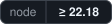
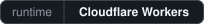
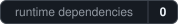
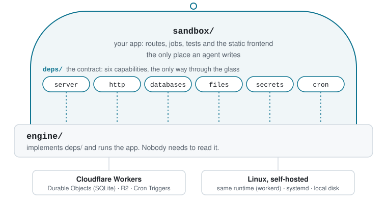
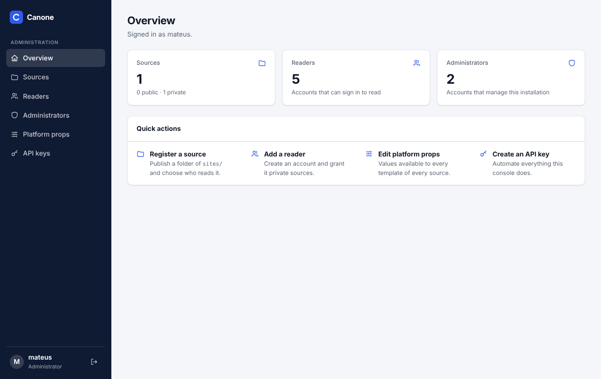
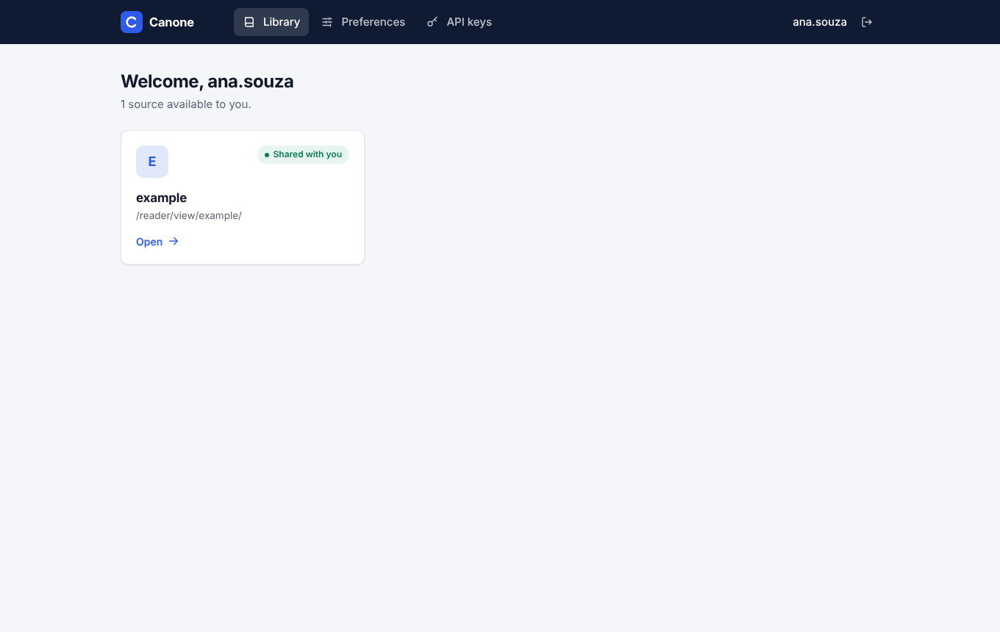

<!-- redoma:header -->
<div align="center">

<picture>
  <source media="(prefers-color-scheme: dark)" srcset="engine/assets/logo-dark.svg">
  
</picture>

**A bell jar for your web server.**<br>
A TypeScript template for Cloudflare Workers and Linux, built to be driven by AI coding agents.

<a href="LICENSE"></a>
<a href="package.json"></a>
<a href="wrangler.jsonc"></a>
<a href="package.json"></a>

</div>

<br>

*Redoma* is Portuguese for a glass bell jar: everything inside is visible, and nothing gets in or out except through it. Your app lives under the jar, in `sandbox/`. It reaches the outside world only through six capabilities declared in `deps/`. An engine you never have to read implements them, on Cloudflare and on your own Linux machine alike.

### What you get

- **A contract an agent reads in a minute.** `deps/` is nine short files of types and examples. That is the whole API.
- **No setup, anywhere.** Databases appear on first use, cron needs no config, files and secrets are one call. Nothing to create in a dashboard, no identifiers to paste.
- **Two ways to publish.** Connect the repository in the Cloudflare dashboard and push, or run one command. Both are first-class.
- **The same app on your own server.** One command installs it as a Linux service with its data on local disk.
- **A lock you control.** `npm run restrict on` confines the app, and the agent, to `sandbox/`. Only a person at a terminal can turn it off.
- **Plain tools.** TypeScript end to end, no build step, no framework, no runtime dependencies. Node is the only prerequisite.

<br>

<p align="center">
<picture>
  <source media="(prefers-color-scheme: dark)" srcset="engine/assets/diagram-dark.svg">
  
</picture>
</p>
<!-- /redoma:header -->

<!-- redoma:project -->
## Canone

**Publish private, read-only sites to the right people, under your own brand.**

Put a static site in a folder, commit it, and Canone serves it behind a sign-in: you decide which readers open which site. It is a white-label template: your logo, name and colours live in one folder, and all data lives in a single SQLite database. No buckets, no external services.

<p align="center">
  
  
</p>

- **One folder per site.** `sites/handbook/` is served at `/reader/view/handbook/`. Plain HTML, CSS, images, PDFs.
- **Access per reader.** A source is private (only the readers you pick) or public (anyone).
- **Server-side templates.** `{{ props.title }}`, ``, ``: pages adapt to the platform, the source and the reader.
- **White-label.** Logo, name and palette in `sites/label/`. No code to touch.
- **Everything has an API.** Whatever the console does, a script can do with an API key.
- **One SQLite database.** Accounts, permissions, sessions and settings; created on first use.

### Get it running in 5 steps

You need [Node.js](https://nodejs.org) 22.18 or newer and a terminal.

**1. Create your repository.** On GitHub press **Use this template** and choose **Private**.

> [!WARNING]
> Whoever can read the repository can read every site in it, including the private ones. Keep the repository private.

**2. Install and name it.** Clone the repository, then:

```bash
npm install
```

```bash
npm run rename my-company-docs
```

**3. Set the three secrets.** Each command asks for the value at a hidden prompt. Use long random values, different from each other (a password manager can generate them).

```bash
npm run secret set CANONE_ROOT_PASSWORD
```

```bash
npm run secret set CANONE_MASTER_KEY
```

```bash
npm run secret set CANONE_SIGNING_KEY
```

| Secret | What it is for | If you change it later |
|---|---|---|
| `CANONE_ROOT_PASSWORD` | Opens `/root/setup`, where administrators are created and recovered. | Nothing breaks. |
| `CANONE_MASTER_KEY` | Mixed into every password and API key hash. **Keep a copy.** | Every password and API key stops working. |
| `CANONE_SIGNING_KEY` | Signs the session cookies. | Everyone is signed out. |

**4. Start it.**

```bash
npm run dev
```

**5. Create the first administrator.** Open the address it printed, then:

1. Go to `/root/setup`, type the root password and create an administrator.
2. Sign in at `/admin/`.
3. **Sources → Register source** and pick `example`.
4. **Readers → Add reader**, then tick `example` for that reader.
5. Sign in as the reader at `/reader/`. The example site is in the library.

That is the whole flow. Now make it yours.

### Add your own sites

Copy each site into its own folder under `sites/` (lowercase letters, digits and hyphens), commit and publish:

```
sites/
  handbook/        →  /reader/view/handbook/
    index.html
    style.css
  price-list/      →  /reader/view/price-list/
  label/           →  your brand (not a site)
```

A folder is invisible until an administrator registers it under **Sources**. Delete `sites/example/` when you no longer need it. Links between pages of a site should be relative (`about/`, `../style.css`).

### Make it your brand

Everything visual about your company is in [`sites/label/`](sites/label/README.md):

| File | Change it to |
|---|---|
| `label.json` | Your product name, tagline and footer. |
| `logo.svg`, `favicon.svg` | Your logo (SVG, PNG, JPG or WebP). |
| `style.css` | Your colours: four `--brand…` values, for light and dark mode. |

The sign-in page, the administrator console and the reader library follow these files. The sites you publish keep their own look.

### Publish

Follow [step 5 of the manual below](#5-publish-to-cloudflare) (Cloudflare) or [step 8](#8-run-it-on-your-own-linux-server) (your own Linux server). Either way, **the three secrets must also be set where the app runs**:

- Publishing from your terminal with `npm run deploy`: `npm run secret set NAME` already sent them.
- Publishing through Git connected to Cloudflare: add them in the dashboard, **Workers & Pages → your Worker → Settings → Variables and Secrets → Add**, type **Secret**.
- A Linux server: run `npm run secret set NAME` on the server.

Sites are part of the publication: to add or change one, commit and publish again.

### Addresses

| Address | What it is |
|---|---|
| `/reader/` | Reader sign-in and library. |
| `/reader/view/<alias>/<file>` | Delivers `sites/<alias>/<file>`. A folder address delivers its `index.html`. |
| `/admin/` | Administrator sign-in and console. |
| `/root/setup` | Creates and removes administrators with the root password. |
| `/api/admin/*`, `/api/reader/*` | The same operations in JSON. Send an API key as `Authorization: Bearer <key>`. The routes are listed in [`sandbox/api.ts`](sandbox/api.ts). |
| `/label/<file>` | Your logo and colours. Public. |

### Templates and props

Files whose extension is in the source's *rendered extensions* (default: `html`) go through the template engine before delivery:

```html
<h1>{{ props.company }}</h1>
………
{{ forloop.index }}. {{ item }}Nothing new.
{{ this is not interpreted }}
```

- **`props`** are JSON objects merged in this order, the later winning: platform (all sources) → source → reader.
- **`query`** is the address query string and **`headers`** the request headers (never cookies or credentials).
- Output is HTML-escaped. Filters: `raw` (no escaping), `json`, `default: "value"`, `upper`, `lower`, `size`.

> [!IMPORTANT]
> Props personalise pages. They are **not** access control: a reader can set any key in their own preferences. Access is decided only by the source's visibility and the reader's permissions.

### Good to know

- **Storage:** one SQLite database (`canone`). On your computer and on Linux it is inside `.data/`: that folder is your backup. No bucket is used.
- **Sessions** last 7 days. Readers cannot change their own password; an administrator does it.
- **Root password:** 5 wrong attempts per hour, counted across all visitors, then it locks until the next hour.
- **Limits:** props up to 64,000 characters; files over 1 MB are delivered without rendering; on Cloudflare, `sites/` holds up to 20,000 files of 25 MB each.
- **A folder removed from `sites/`** keeps its settings, shows as "Folder missing" in the console and answers 404.
- **`sites/` and `sandbox/public/` cannot coexist**, and `label` cannot be the name of a site.

### Contributing

Issues and pull requests are welcome. The app is in `sandbox/` (TypeScript, no dependencies); run `npm run test` before sending a change. The rest of this file is the manual of [Redoma](https://github.com/MateusMoutinhoOrg/Redoma), the template Canone is built on: it covers every command in detail.
<!-- /redoma:project -->

## Quickstart

You need [Node.js](https://nodejs.org) 22.18 or newer. Nothing else.

```bash
npm install
```

```bash
npm run rename my-app
```

```bash
npm run dev
```

Open the address it prints. You should see a small notes page that saves to a database. That page is the example app, in `sandbox/`.

> [!WARNING]
> The example has no login. Anyone who can reach a published copy can read and add notes. Add your own access control before you put anything private in it.

## The four folders

- `sandbox/` is your app, and the only place an agent writes by default. `main.ts` is the entry point, `public/` holds the static frontend (plain HTML, CSS and JavaScript), and tests sit next to the code as `*.test.ts`.
- `deps/` is the contract: type declarations with documentation and examples for everything the app can use. There is no `docs/` folder; these files are the docs.
- `engine/` implements `deps/` and runs the app. You should never need to open it.
- `scripts/` has one file per command below.

## Step by step

### 1. Create your repository

On GitHub, press **Use this template** → **Create a new repository**. It can be private. Clone it to your computer and open a terminal in its folder.

### 2. Install and name it

```bash
npm install
```

```bash
npm run rename my-app
```

`rename` puts your project's name everywhere it is needed. Use lowercase letters, digits and dashes. Do it now: renaming a published app later creates a new, empty one.

### 3. Run it on your computer

```bash
npm run dev
```

It uses the first free port from 3000 upward and prints the address. It reloads when you save a file in `sandbox/`. Stop it with Ctrl+C. What the app stores goes to the `.data/` folder.

### 4. Check your work

```bash
npm run test
```

It checks types, runs the restrict gates if the lock is on, and runs the tests in `sandbox/` against the real local runtime. If it prints `✓ All good`, the work is ready. Agents run this before they say they are done.

### 5. Publish to Cloudflare

There are two ways. Pick one; you can switch later.

**A. Connect the repository in the dashboard (no command line login)**

1. Push your repository to GitHub.
2. In the [Cloudflare dashboard](https://dash.cloudflare.com), open **Workers & Pages** and select **Create application**.
3. Select **GitHub**, authorize Cloudflare if it asks, and pick your repository.
4. For the project name, type the same name you gave `npm run rename`. Leave the build command empty and keep the deploy command it suggests (`npm run deploy` or `npx wrangler deploy`; both work).
5. Select **Save and Deploy**. When it finishes, the page shows your app's address.

From then on, every push to your main branch publishes the app. Cloudflare runs the same checks as `npm run deploy` before it deploys, so a push that would fail `npm run test` on types or on the restrict lock is not published.

**B. From your terminal**

```bash
npm run deploy
```

The first time, it opens a browser so you can log in to Cloudflare. Then it checks the app, publishes it and prints the address. For unattended use, set `CLOUDFLARE_API_TOKEN` and `CLOUDFLARE_ACCOUNT_ID` in the environment instead of logging in.

To check everything without publishing (no login needed):

```bash
npm run deploy:check
```

A free Cloudflare account is enough. One exception: an app that uses `files` needs R2 turned on for the account (dashboard → **R2** → finish the one-time setup). Apps that do not use `files` need nothing.

### 6. Secrets

A secret is an API key or token your app needs. The app reads it with `deps.secrets.get("NAME")`. You set it; an agent never does.

```bash
npm run secret set NAME
```

It asks for the value at a hidden prompt (it never appears on screen, in your shell history or in a chat), saves it on this machine, and tells you exactly where else it went.

A secret has to be set in each place the app runs:

| Where the app runs | How to set the secret there |
|---|---|
| Your computer (`npm run dev`) | `npm run secret set NAME` |
| Cloudflare, published from your terminal | The same command sends it to Cloudflare too when the terminal is logged in. It says so. |
| Cloudflare, published through Git | In the dashboard: **Workers & Pages** → your app → **Settings** → **Variables and Secrets** → **Add** → type **Secret** → enter the name and value → **Deploy** |
| A Linux server | `npm run secret set NAME` on that server |

Secrets added in the dashboard stay there through every later deploy, from either way of publishing. Tests never use real secrets; each test supplies its own made-up values.

```bash
npm run secret list
```

```bash
npm run secret remove NAME
```

`list` shows names only, never values. If the app asks for a secret that is not set, the error names the secret and repeats these instructions.

### 7. Update the template

```bash
npm run update
```

It downloads the latest version of this template and replaces `engine/`, `deps/`, `scripts/` and the root files the template owns (`README.md`, `AGENTS.md`, `CLAUDE.md`, `tsconfig.json`, `.gitignore`; `package.json` is merged). In `README.md` it keeps what you wrote between the `redoma:project` markers, right under the title; the rest of the file is the template's manual and is replaced. It never touches `sandbox/`. It refuses to run while those files have uncommitted changes, shows what will change, asks you to confirm, and then tells you whether your app still passes. Run it yourself; agents are told not to.

### 8. Run it on your own Linux server

The same app runs on a Linux machine with systemd, with all its data on that machine's disk.

```bash
npm run service:install
```

It installs a service on port 3000 that restarts on failure and starts on boot. Give a port (`npm run service:install 8080`) or a range to take the first free port in it (`npm run service:install 3000:3100`).

```bash
npm run service:status
```

```bash
npm run service:remove
```

To have the server follow your repository, install the watcher. Every 60 seconds (or the number you give) it pulls new commits and restarts the service:

```bash
npm run watcher:install
```

```bash
npm run watcher:remove
```

Things to know:

- No `sudo` is involved. If you run a command with `sudo` by mistake it refuses, because root-owned files in the project would break every later command. To keep the service running after you log out, one administrator command may be needed once; `service:install` prints it if so.
- The service listens on all network interfaces over plain HTTP. For HTTPS, put a reverse proxy (Caddy, nginx) or a Cloudflare Tunnel in front of it. A proxy on the same machine is trusted to report the visitor's address and `https`.
- Secrets are not in the repository. Set them on the server too.
- For a private repository, the server needs its own access to it (a deploy key) for the watcher to pull.

## Where your data lives

- On Cloudflare: databases are SQLite-backed Durable Objects, files are in an R2 bucket named after your app. Both are created automatically.
- On your computer and on a Linux server: everything is in the `.data/` folder inside the project. **That folder is what you back up.** Stop the service before copying it. `.data/` and the secrets file `.dev.vars` are never committed.

## Restrict mode

By default the sandbox is open: it may import npm packages, and agents are only *asked* to stay inside `sandbox/`. Locking it is your decision.

```bash
npm run restrict on
```

```bash
npm run restrict status
```

```bash
npm run restrict off
```

With the lock on:

1. **Imports.** `dev`, `test`, `deploy`, Cloudflare's builds and the Linux service refuse sandbox code that imports anything other than files in `sandbox/` and `deps/`. Dynamic `import()`, `require`, `eval`, `new Function`, `.constructor` tricks and `globalThis`/`self` are refused too.
2. **Globals.** Every global the sandbox touches is checked against the list in `deps/globals.ts`. There is no `fetch`, no `process`, no bindings: only the JavaScript language, that list, and `deps`.
3. **The agent.** Claude Code is denied edits to `engine/`, `deps/`, `scripts/`, the root configuration, its own settings and the lock itself, and denied running the `restrict`, `secret` and `update` commands.

`restrict off` asks for confirmation at a terminal, so an agent cannot switch it off. `restrict status` also tells you if a protected file changed since you locked.

Be clear about what this is: **a strong guardrail, not a security boundary.** An agent with unrestricted shell access can still change files with ordinary shell commands, outside Claude Code's edit tools. Other agents ignore Claude Code's settings entirely; only gates 1 and 2 cover them. If you need a real boundary, use the operating system: run the agent in a container or virtual machine that only mounts `sandbox/` for writing, as a separate user without write permission to the rest of the project, or with your agent's own OS-level sandbox (Claude Code has one for shell commands).

## Known limitations

- **No login.** There is no authentication capability in this version. Anything you publish is public until you build access control into your app.
- **Linux runs Cloudflare's local runtime.** The service runs the same Worker under `workerd` through Wrangler, which Cloudflare documents for development and testing. Redoma puts its own front door before it and never exposes the runtime's maintenance endpoints, but expect roughly 300 MB of memory, and treat it as a single-machine setup.
- **Cloudflare's free plan.** 100,000 requests a day, 10 ms of CPU per request and per cron run (waiting on a database or the network is free), 50 outbound `http` calls per request, 5 GB of database storage. An app that uses `cron` takes one of the account's five Cron Triggers.
- **Databases.** Integers beyond ±2^53 lose precision when read. There are no `BEGIN`/`COMMIT`; use `batch`. Each database is limited to 10 GB.
- **Cron.** Minute precision, UTC. A run that fails is not retried, and minutes missed while the app was down are not made up.
- **Files.** Need R2 enabled on the Cloudflare account. `list` returns at most 1000 entries.
- **Renaming is a new identity.** After `rename`, a published app becomes a new app with empty data, and local data stays under the old name.
- **Preview deployments for other branches** are not set up; only the production branch is covered.
- **`wrangler.jsonc` is generated.** Do not edit it. Custom domains and similar settings are made in the Cloudflare dashboard and survive deploys.
- **If a Cloudflare build fails on `npm ci` with "out of sync"**, your npm is newer than the builder's. Add your npm version to `package.json` as `"packageManager": "npm@<version>"`.
- Developed and tested on Linux. The service commands are Linux-only.

## Commands

| Command | What it does |
|---|---|
| `npm run rename NAME` | Rename the project everywhere it is named. |
| `npm run dev` | Run locally on the first free port from 3000 and print the address. |
| `npm run test` | Check types, run the restrict gates if on, run the sandbox tests. |
| `npm run deploy` | Check, publish to Cloudflare, print the address. |
| `npm run deploy:check` | Check and build only. Publishes nothing. |
| `npm run secret set NAME` | Store a secret on this machine and, when logged in, on Cloudflare. |
| `npm run secret list` | Show secret names. Never values. |
| `npm run secret remove NAME` | Delete a secret. |
| `npm run restrict on` / `off` / `status` | Lock the app into `sandbox/`, unlock it, or inspect the lock. |
| `npm run update` | Bring `engine/`, `deps/`, `scripts/` and the template's root files up to date. |
| `npm run service:install [PORT or FROM:TO]` | Install the app as a systemd service (default port 3000). |
| `npm run service:remove` | Remove the service. |
| `npm run service:status` | Show whether it runs, its port and recent log lines. |
| `npm run watcher:install [SECONDS]` | Pull new commits and restart the service every SECONDS (default 60). |
| `npm run watcher:remove` | Remove the watcher. |

Every command prints one line when it succeeds. When it fails it says what went wrong, where, and what to do next. Full tool output is kept in `.wrangler/redoma/` for whoever needs it.

Changing the template itself? Run `node engine/selftest/run.ts` afterwards: it drives every command against a fixture app that uses every capability.

## License

[MIT](LICENSE). The license covers the template. Your own app is yours: keep, replace or remove the file as you see fit.
